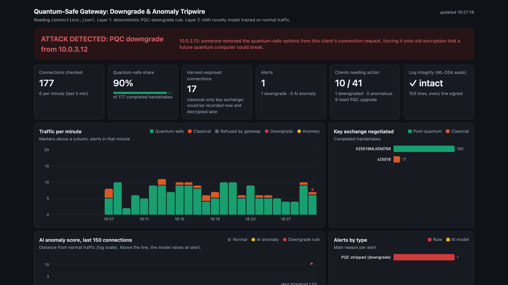
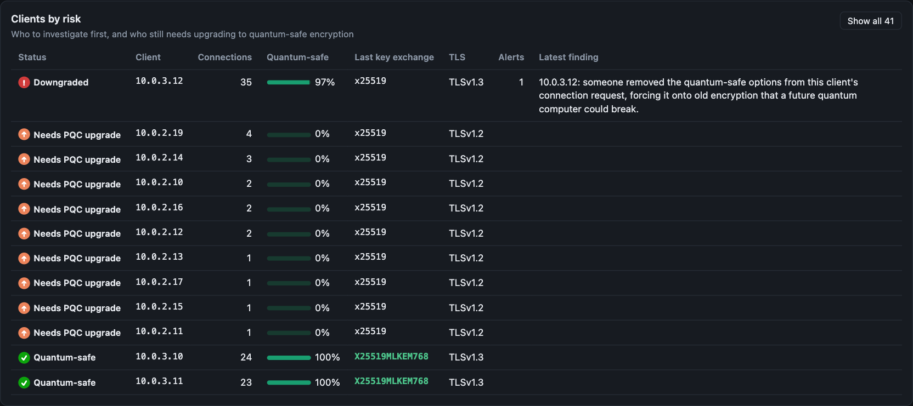
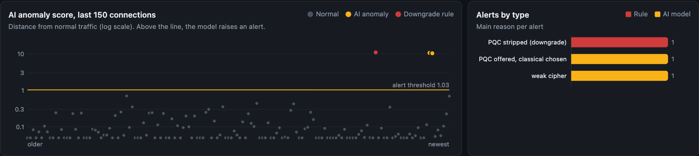
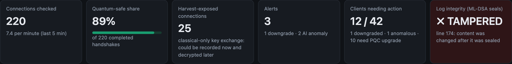

# [Entities_IBM Z Datathon 2026 Project]

> **IBM Z Datathon 2026 — Theme 2: AI Secured** · *Powerful AI. Protected Data.*
> **Event code: SSF2026** · University of Manchester hub, 17–18 Oct 2026
> Built from scratch during the hacking window on **IBM LinuxONE (s390x)**.

**Quantum-Safe Gateway** — a drop-in reverse proxy that makes an old, vulnerable service
quantum-safe **without changing the service**, and an AI tripwire that spots attackers trying
to force it back to breakable crypto.

---

## The problem

Attackers can record encrypted traffic **today** and decrypt it years from now, once quantum
computers mature — "harvest now, decrypt later". Shor's algorithm breaks the RSA/ECC key
exchange that protects almost all traffic; Grover's halves symmetric-key strength. Anything
that must stay secret for a decade (financial, health, government data) is already at risk.
Rewriting every legacy system is slow or impossible.

## Our solution

A gateway sits in front of the legacy service and transparently upgrades its security:

1. **Hybrid post-quantum key exchange** — X25519 + **ML-KEM-768** (FIPS 203). Recorded traffic
   can't be decrypted by a future quantum computer.
2. **Post-quantum authentication** — the gateway's certificate is signed with **ML-DSA-65**
   (FIPS 204), so a quantum attacker can't forge its identity either.
3. **Data & log integrity** — AES-256-GCM encryption with ML-KEM-wrapped keys, and every line
   of the connection log sealed with ML-DSA so tampering is detectable to the exact line.
4. **AI downgrade/anomaly detector** — a model learns normal handshake patterns and raises a
   red alert when someone forces a fallback to weak classical crypto, in real time.
5. **Benchmarked on LinuxONE** — classical vs post-quantum handshake latency, throughput and
   key sizes, measured on s390x.

The legacy service is never modified. The gateway does all the work.

## Demo (three scenes)

1. **Break it:** the attacker factors the legacy service's (deliberately tiny) RSA key in
   under a second and reads the "encrypted" records.
2. **Defend it:** the same attacker, recording traffic through the gateway, finds no RSA to
   factor — the post-quantum key exchange leaves nothing breakable on the wire.
3. **Catch it:** a forced-downgrade attempt makes the detector's dashboard turn red, and the
   ML-DSA-sealed log proves the record of the attack wasn't altered.

> The quantum attack is a **scaled-down simulation** — a 64-bit toy RSA key factored on a
> normal CPU, to show the *shape* of Shor's threat in seconds. No quantum computer is used,
> and production RSA-2048 is not broken. See each component's README for honest limitations.

## Why IBM Z / LinuxONE (platform evidence)

- Post-quantum crypto runs **natively on s390x** — the architecture behind most of the world's
  financial transactions. Verified: `uname -m` → `s390x`, machine type **9175 (IBM z17)`,
  `go version go1.27.2 linux/s390x`, Ubuntu 24.04.5 LTS.
- **CPACF** on-chip crypto acceleration is present (`msa` CPU feature); AES-256-GCM via OpenSSL
  uses it. The account is in the `cpacfstats` group.
- **Containerised** on LinuxONE: a multi-stage Docker build produces a ~9 MB native s390x image
  with no secrets baked in (`docker ps`, `uname -m`, `docker images`).
- Go 1.27's standard library ships `crypto/mlkem` and `crypto/mldsa`, so the whole gateway is
  post-quantum with **no third-party crypto** — a clean fit for the platform's security story.

*(Screenshots: see `/screenshots` — commands listed in `gateway/README.md`.)*

## Dashboard

The detector's live dashboard, during a scripted attack. The dashboard, detector, AI model and ML-DSA log seals are the real code; the bank traffic and attacks are simulated by `demo_tools/handshake_feed.py`.

**A downgrade attack is caught.** Someone strips the post-quantum options from a client's handshake; the banner turns red with a plain-English explanation. The tiles show how much traffic is quantum-safe, how much could be harvested today, and how many clients need action.



**Who to investigate, and who to upgrade.** Clients are sorted by risk: the downgraded client first, then legacy clients that still need a post-quantum upgrade.



**The AI model catches what the rule can't.** Each dot is a connection's distance from normal traffic; above the line, the kNN model raises an alert, for example a client that offered post-quantum but landed on classical, or a cipher weaker than it normally uses.



**Tampering with the audit log is detected.** Every log line is sealed with an ML-DSA-65 signature chain; editing a line to hide the attack flips the integrity tile to TAMPERED, naming the line.



Run it yourself with `./demo.sh` (step 4 opens the dashboard). Regenerate these screenshots with `.venv-anim/bin/python animations/record_dashboard.py --stills`.

## Repository structure

```
gateway/        A — reverse proxy, hybrid PQ-TLS, ML-DSA cert, benchmarks, Docker  (Go)
pqc/            B — lock/unlock + sign/verify + sealed logs (ML-KEM, ML-DSA, AES-256-GCM) (Python)
legacy_server/  C — the weak toy-RSA legacy service                                 (Python)
attacker/       C — harvest-now-decrypt-later + forced-downgrade simulations        (Python)
detector/       D — AI downgrade/anomaly tripwire + live dashboard + log-integrity  (Python)
practice_data/  C — synthetic traffic for the detector
```

## Getting started

```bash
git clone https://github.com/renarustamli/IBMZ-Datathon-2026.git
cd IBMZ-Datathon-2026

# A — gateway (Go 1.27+)
cd gateway && go build -o gateway . && go build -o gencert/gencert ./gencert
./gencert/gencert -pq            # post-quantum (ML-DSA-65) demo certificate
./test.sh                        # end-to-end: hybrid client connects, classical refused

# B — crypto layer (pure-Python PQ libs)
pip install -r pqc/requirements-crypto.txt
python pqc/qsafe_crypto.py selftest

# C — legacy service + attacker demo
pip install -r requirements.txt
#   see SCENES.md for the three-scene run order

# D — detector + dashboard
pip install -r detector/requirements.txt    # or apt: python3-{numpy,scipy,sklearn,flask}
LOG_FILE=../gateway/logs/connections.jsonl python detector/dashboard.py   # http://localhost:5000
```

## Open-source libraries (required for submission)

| Library | Used by | Purpose |
|---|---|---|
| Go standard library (`crypto/tls`, `crypto/mlkem`, `crypto/mldsa`, `crypto/x509`, `crypto/ecdh`) | A | Hybrid PQ-TLS, ML-DSA certificate, benchmarks |
| [kyber-py](https://github.com/GiacomoPope/kyber-py) | B | ML-KEM-768 (FIPS 203), pure Python |
| [dilithium-py](https://github.com/GiacomoPope/dilithium-py) | B | ML-DSA-65 (FIPS 204), pure Python |
| [cryptography](https://cryptography.io) | B | AES-256-GCM (OpenSSL / CPACF) |
| [SymPy](https://www.sympy.org) | C | Factoring the toy RSA key in the attack demo |
| [scikit-learn](https://scikit-learn.org) | D | kNN novelty model for the anomaly detector |
| [NumPy](https://numpy.org) | D | Feature vectors |
| [Flask](https://flask.palletsprojects.com) | D | Live detector dashboard |
| [Docker](https://www.docker.com) | A | Native s390x containerisation |

All code was written during the 17–18 Oct 2026 hacking window. Standards: NIST FIPS 203
(ML-KEM) and FIPS 204 (ML-DSA).

## Honest scope

- The quantum attack is a simulation on a toy key (above).
- Key exchange and authentication are post-quantum; the **session cipher is AES-128-GCM** —
  Go's TLS 1.3 does not allow selecting AES-256. Grover leaves AES-128 at ~64-bit quantum
  security, still impractical to attack but not AES-256.
- ML-KEM/ML-DSA are young NIST standards; the key exchange stays **hybrid** (X25519 + ML-KEM)
  so a break in ML-KEM alone doesn't lose the session.
- Demo certificates are self-signed; a real deployment needs a PQ-capable certificate authority.

## Team

| Role | Area | Name |
|------|------|------|
| A | Gateway, PQ-TLS, hardware, benchmarks, containerisation | Viral |
| B | Crypto layer (encrypt / decrypt / sign / verify / sealed logs) | Talen |
| C | Legacy service + attacker simulations | Diya |
| D | AI downgrade/anomaly detector + dashboard | Rena |
| E | Pitch, video, submission | Everyone |
| F | Animation, parts of presentation, Demo production | Calvin |


## Flowcharts


